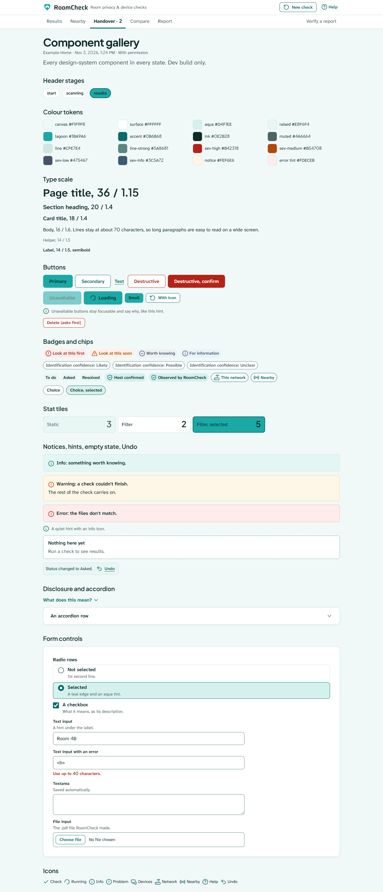

# RoomCheck design system

RoomCheck should feel precise, calm and capable, with a bright summery teal. The brand comes from repeating a few deliberate choices, not from decoration:

- **Lagoon** (`#1BA9A6`) is for the logo, primary buttons and selected fills.
- **Deep teal** (`accent`) is for links, small teal text and the active-tab underline.
- **Light aqua** is for tints.
- **Severity colours** are used only for findings, warnings and destructive actions.

Everything below lives in code:

| What | Where |
|---|---|
| Tokens (colour, type, spacing, shapes, shadow, motion) | [web/src/styles/tokens.css](../web/src/styles/tokens.css) |
| Base styles, focus ring, scroll padding, scan sweep, reduced motion | [web/src/styles/index.css](../web/src/styles/index.css) |
| Class recipes (buttons, cards, badges, chips, fields, notices) | [web/src/ds/classes.ts](../web/src/ds/classes.ts) |
| Components | [web/src/ds/](../web/src/ds/) |
| Icons (lucide-react, bundled) | [web/src/components/icons.tsx](../web/src/components/icons.tsx) |
| Contrast script | [web/scripts/contrast.mjs](../web/scripts/contrast.mjs) |
| Gallery (dev build only) | [web/src/gallery/Gallery.tsx](../web/src/gallery/Gallery.tsx), at `/gallery` |



## Rules

1. **No one-off values.** Components use token utilities (`text-ink`, `p-2`, `rounded-card`), never hex codes, `[arbitrary]` values or `style=""`. The CSP forbids inline styles, so all styling is Tailwind classes or CSS files.
2. **Lagoon is a fill, never a line or text.** On white it's only 2.89:1. Lines and text in teal use `accent`.
3. **Filled teal means selected.** Only a selected chip, a pressed filter tile and the primary button are filled lagoon. A selected radio row gets a deep-teal edge and an aqua tint.
4. **The focus ring is ink, not teal**, so it can't be mistaken for a selection. It's a 3 px outline on every control (`:focus-visible` in index.css).
5. **Severity colour is reserved** for findings, notices and destructive actions. Every priority badge also has its own icon shape, so it never relies on colour alone.
6. **No pills except badges and chips.** Controls use 8 px radii and cards use 12 px.
7. **Body text is at most about 70 characters a line** (`max-w-measure`).
8. **Wording rules still apply.** Nothing says "safe", and fixed rules set every priority.

## Tokens

### Colour

| Token | Value | Use |
|---|---|---|
| `canvas` | #F1F9F8 | page background |
| `surface` | #FFFFFF | cards, header |
| `aqua` | #D4F1EE | soft accents, selected tints |
| `raised` | #E8F6F4 | tinted boxes inside cards |
| `line` / `line-strong` | #CFE7E4 / #5A8681 | decorative borders / control edges |
| `disabled` | #EEF2F2 | unavailable controls |
| `ink` / `muted` | #0E2B28 / #4A6664 | text / secondary text |
| `lagoon` / `lagoon-hover` | #1BA9A6 / #3FBDBA | brand, primary buttons, selected fills |
| `accent` / `accent-hover` | #0B6B68 / #08605D | links, small teal text, underline |
| `focus` | #0E2B28 | focus ring |
| `sev-high` `sev-medium` `sev-low` `sev-info` (+ `-tint`) | #B42318 #B54708 #475467 #3C5A72 | findings only |
| `notice`, `error-tint`, `info-tint` (+ lines) | | notices |
| `danger` / `on-danger` | #B42318 / #FFFFFF | destructive buttons |

**Contrast.** Every text-on-background, icon, control-edge and focus pair the design uses is listed in `PAIRS` in `scripts/contrast.mjs`. Run it with `node scripts/contrast.mjs`. The ratios are recorded at the top of tokens.css, and `src/styles/contrast.test.ts` fails if any pair drops below AA (4.5:1 for text, 3:1 for large text, icons, edges and focus). Key results:

- Ink on lagoon is 5.21, so primary buttons are lagoon with ink text.
- Accent on white is 6.33.
- Line-strong on white is 4.07.

### Type

Four families, all bundled with the app (`@fontsource` packages, imported in `web/src/main.tsx`)
and with the PDF report (`app/report/data`). There are no Google Fonts or other font requests:
the CSP keeps `font-src 'self'`, and RoomCheck works offline. Only the weights used are loaded,
each with `font-display: swap` and system fallbacks. All four are under the SIL Open Font License
1.1 ([FONT-LICENSES.md](../FONT-LICENSES.md)).

| Family | Weights | Where | Token / class |
|---|---|---|---|
| Plus Jakarta Sans | 600, 700 (400 for digits only) | Headings (`h1`–`h4`), card titles, the summary headline; digits 0–9 in body text | `--font-display` (set on headings in `index.css`) |
| Atkinson Hyperlegible Next | 400, 600, 700 | Body and UI text: paragraphs, labels, buttons, chips, tables, nav (700: the current page) | `--font-sans`, the page default |
| JetBrains Mono | 400 | Fingerprints, hashes and other machine values | `font-mono` |
| Saira | 600 | The RoomCheck wordmark only | `font-wordmark` |

Atkinson Hyperlegible Next's zero is slashed, and its files have no feature for an unslashed one
(only tabular figures, `tnum`); at small sizes "10" can read like "19". So digits 0–9 come from
Plus Jakarta Sans: `web/src/styles/digits.css` declares Plus Jakarta faces at 400, 600 and 700
under the family name "Atkinson Hyperlegible Next" with `unicode-range: U+0030-0039`, after
Atkinson's own faces, so the browser takes every digit from them and every letter from Atkinson.
The PDF does the same (`REPORT_FONTS` in `app/report/render.py`). JetBrains Mono keeps its own
digits for hashes.

| Role | Family, weight | Size / line height | Class |
|---|---|---|---|
| Page title | Plus Jakarta Sans 700 | 28 px (36 px from `sm`) / 1.15 | `text-xl sm:text-2xl font-bold` |
| Section heading | Plus Jakarta Sans 600 | 20 / 1.4 | `text-lg` |
| Card title | Plus Jakarta Sans 600 | 18 / 1.4 | `text-card` |
| Summary headline | Plus Jakarta Sans 600 | 20 (28 from `sm`) / 1.4 | `text-lg sm:text-xl font-semibold` |
| Body | Atkinson Hyperlegible Next 400 | 16 / 1.6 | `text-base` |
| Helper | Atkinson Hyperlegible Next 400 | 14 / 1.5 | `text-sm text-muted` |
| Label, button | Atkinson Hyperlegible Next 600 | 14–16 / 1.5 | `text-sm font-semibold` |
| Machine value | JetBrains Mono 400 | 14 / 1.5 | `font-mono text-sm` |
| Wordmark | Saira 600 | 21 / 1 | `font-wordmark text-brand` |

The PDF uses the same families: body 10.5 pt Atkinson Hyperlegible Next (digits from Plus
Jakarta Sans), headings Plus Jakarta Sans (title 18 pt 700, sections 13 pt and cards 11 pt 600).

### Spacing, layout, shape, motion

- **Spacing is an 8 px scale:** `--spacing: 0.5rem`, so `p-1` = 8 px and `p-3` = 24 px. Note that `w-48` is 384 px, not 192 px as in default Tailwind.
- **Widths:**
  - `max-w-content` is 1040 px, for every page.
  - `max-w-form` is 640 px, for Report, Verify and Notes.
  - `max-w-narrow` is 832 px, for the Start column.
  - `max-w-measure` is 70ch, for body text.
- **Phones:** everything stacks and nothing scrolls sideways, down to 320 px.
- **Radii:** `rounded-control` 8 px, `rounded-card` 12 px, `rounded-inner` 8 px. `rounded-full` is for badges and chips only.
- **Shadow:** one level, `shadow-soft`.
- **Motion:**
  - Transitions are 150 ms.
  - The spinner uses `motion-safe:animate-spin`.
  - One scan sweep (`.scan-sweep`) runs on the Scanning card while a check runs.
  - Everything stops under `prefers-reduced-motion`.

## Components (`web/src/ds/`)

| Component | States and notes |
|---|---|
| `Button` | `primary`, `secondary`, `text`, `destructive`, `destructive-confirm`. `unavailable` sets `aria-disabled`, stays focusable and should be paired with a hint via `aria-describedby`. `loading` sets `aria-busy` and shows a spinner. Both make clicks do nothing. Sizes `md` and `sm`. |
| `ConfirmButton` (components/) | A destructive action that asks first. "No" is focused, and focus returns to the trigger. |
| `Card` | Standard padding. Use it for meaningful groups, not around every small item. |
| `PriorityBadge`, `ConfidenceBadge`, `StatusBadge`, `EvidenceBadge`, `SourceBadge` | Each kind looks different: priority is a tinted pill with an icon, confidence is outlined grey, status is a raised tag, evidence is aqua with a shield, source is outlined teal with an icon. |
| `chipClass(selected)` | Filter chips. Filled lagoon only when selected. |
| `Disclosure`, `Accordion` | Native `<details>`. The chevron rotates when open. |
| `Notice` | `info`, `warning`, `error` tones. |
| `Hint`, `EmptyState` | Quiet helper line; "nothing here yet" with what to do next. |
| `StatTile` | Static, or a filter (`aria-pressed`, filled when pressed). |
| `RadioRow`, `Checkbox` | The whole row is the target. The hint is the accessible description. |
| `TextInput`, `Textarea`, `FileInput` | Label, hint and error, wired with `aria-describedby` and `aria-invalid`. |
| `UndoToast` | `aria-live="polite"`, with an Undo button. It expires after 15 s. |
| `PageHeader` | The h1 (focused when you move to a page), the scan-context line after a check (network · date and time · mode) and an optional intro. |
| `AppHeader` | The one header (below). |

### Header

The header is sticky, white, with a subtle bottom border. A light shadow appears once content scrolls under it.

- **Brand row:** the mark, the wordmark and the descriptor (hidden below `sm`), with stage actions on the right.
- **Nav row (`<nav aria-label="Main">`, after a check):** Results, Nearby, Handover, Compare, Report, with Verify a report at the far right.
- **Active page:** a 3 px deep-teal underline and bold text, never a fill. Only one page is ever `aria-current="page"`.
- **Handover:** shows "Handover · 2", read as "Handover, 2 open tasks". No other tab gets a badge.
- **Stages:**

  | Stage | Shows |
  |---|---|
  | Start | Help and Verify, plus Compare if a saved scan exists (even an unreadable one) |
  | Scanning | "Check in progress" (a link back to the check from other pages) and Help |
  | After a check | The nav row plus **New check** |

- **New check** asks first. It says the current results will be replaced and that handover tasks, statuses and notes are kept. Without a saved move-in scan, it offers "Save as my move-in scan first" or "Start without saving". Escape or "Keep these results" closes it and returns focus. On a phone the panel spans the header width.
- **Phone:** a compact one-line brand row (Help shows as an icon, with "Help" as its name) and a tab row that scrolls sideways with a fade cue. A focused tab scrolls fully into view.
- **Focus Not Obscured (WCAG 2.2 2.4.11):** `scroll-padding-top` on `html` reserves the header's height: compact before a check, full once the nav row shows. Focused controls, "Review finding" targets and headings land below the header. `e2e/design.spec.ts` tabs through pages forwards and back and checks this at each stop.

## Tests

- `src/styles/contrast.test.ts`: every token pair passes AA.
- `src/ds/ds.test.tsx`: each component in each state.
- `src/ds/Header.test.tsx`: stage variants, New check with and without a saved scan, the open-task count, a single current page, and the sticky shadow.
- `e2e/design.spec.ts`: on every screen including Help, at laptop and phone sizes, 200% zoom (640 px) and 320 px:
  - axe at WCAG 2.2 AA
  - a visible focus ring on every Tab stop
  - focus never under the header
  - no sideways scrolling
  - the phone tab row
  - the scan sweep under reduced motion

## Screenshots

```
cd web
SHOTS_DIR=../docs/screenshots/design-pass npm run shots           # every screen, 1280 and 390 px
SHOTS_DIR=../docs/screenshots/design-pass npm run shots:gallery   # the gallery (starts the Vite dev server)
```

All screenshots use made-up data, and no request leaves the machine.
